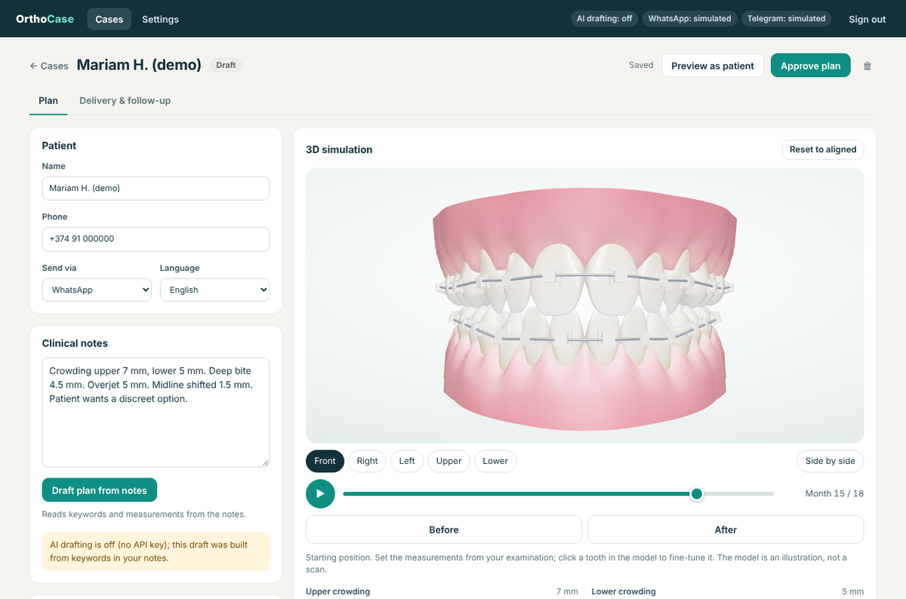
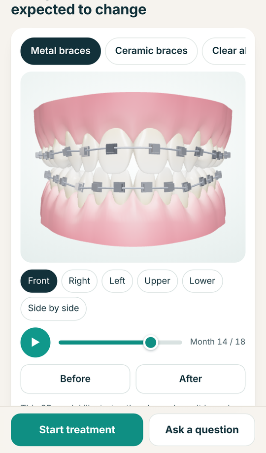
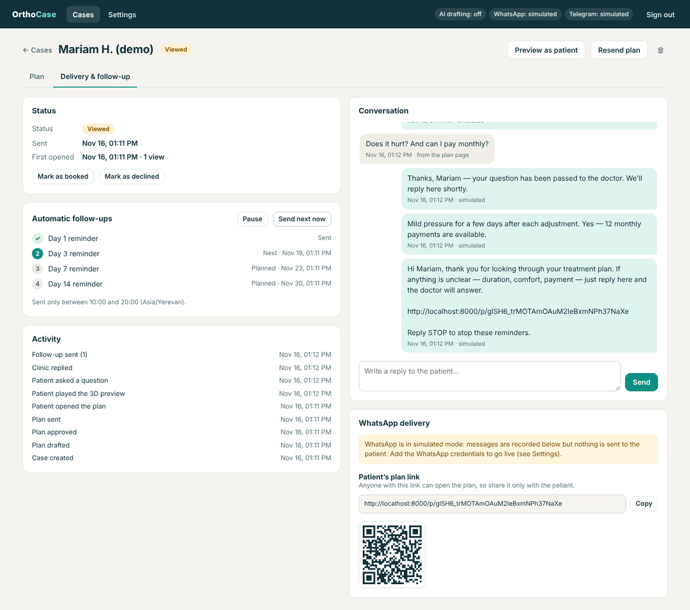
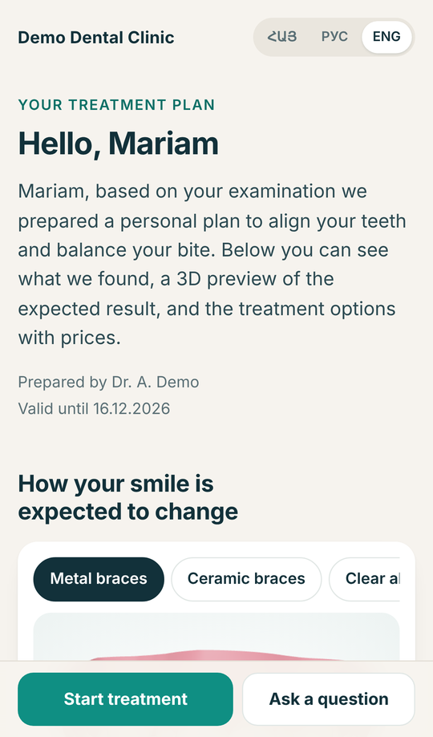

# OrthoCase

Case-acceptance software for cash-pay orthodontic clinics. It turns a dentist's
notes, X-rays and photos into a clear treatment plan with a 3D before/after
simulation and pricing options, sends it to the patient over WhatsApp or
Telegram, and follows up automatically until the patient books or declines.

Built for Armenia / CIS: prices in AMD by default, patient-facing text in
Armenian, Russian and English.

## How it works

1. **Create a case** – patient name, phone, channel, language; write clinical
   notes and upload X-rays and photos.
2. **Draft the plan** – Claude reads the notes and images and drafts a
   plain-language summary, findings, the starting position for the 3D model and
   up to three treatment options from your catalog. Without an API key the draft
   is built from keywords and measurements in the notes instead.
3. **Review and edit** – the dentist adjusts the text, the 3D starting position
   (sliders, or click a tooth to fine-tune it) and each option's price,
   installments and expected result. Nothing reaches a patient before
   **Approve**.
4. **Send** – the patient gets a message with a private link.
5. **Patient page** – 3D simulation with a treatment timeline and side-by-side
   view, what was found, shared images, options with monthly installments, and
   three actions: *Start treatment*, *Ask a question*, *Not right now*.
6. **Follow-up** – reminders on day 1, 3, 7 and 14, only inside your sending
   hours. They stop the moment the patient books, declines or replies STOP, and
   pause while a question is waiting for your answer.

The dashboard shows who opened their plan, who played the 3D preview, who needs
a reply, the acceptance rate and the value booked.

## Screens

| Plan editor (clinic) | Patient page (phone) |
| --- | --- |
|  |  |

| Delivery and follow-up (clinic) | Patient page, top |
| --- | --- |
|  |  |

Captured in simulated mode with made-up demo data.

## Quick start

```bash
cd OrthoCase
python3 -m venv .venv && . .venv/bin/activate
pip install -r requirements.txt
cp .env.example .env          # set ORTHO_ADMIN_PASSWORD at least
python run.py
```

Open <http://localhost:8000> and sign in. With no other settings, everything
works in **simulated mode**: messages are recorded in the case timeline but
nothing is sent, so you can try the whole flow safely. Requires Python 3.10 or
newer (developed and tested on 3.13).

## Configuration

Set these as environment variables or in `OrthoCase/.env`.

| Variable | Purpose |
| --- | --- |
| `ORTHO_ADMIN_PASSWORD` | Dashboard password. If unset, a random one is printed at startup. |
| `ORTHO_PUBLIC_URL` | Public address of the server, used in patient links. Must be `https://…` in production. |
| `ORTHO_DATA_DIR` | Where the database and uploaded images live (default `./data`). |
| `ORTHO_SECRET_KEY` | Session signing key. Generated and stored in the data directory if unset. |
| `ANTHROPIC_API_KEY` | Turns on AI drafting. `ORTHO_AI_MODEL` overrides the model (default `claude-opus-5-5`). |
| `TELEGRAM_BOT_TOKEN` | Turns on Telegram. Optional `TELEGRAM_STAFF_CHAT_ID` for staff alerts. |
| `TELEGRAM_MODE` | `polling` (default, no public URL needed) or `webhook` with `TELEGRAM_WEBHOOK_SECRET`. |
| `WHATSAPP_TOKEN`, `WHATSAPP_PHONE_NUMBER_ID` | Turn on WhatsApp (Cloud API). |
| `WHATSAPP_APP_SECRET`, `WHATSAPP_VERIFY_TOKEN` | Verify incoming WhatsApp webhooks. |
| `WHATSAPP_TEMPLATE_PLAN`, `WHATSAPP_TEMPLATE_FOLLOWUP` | Names of your approved message templates. |
| `WHATSAPP_API_VERSION` | Graph API version (default `v21.0`; set the current one). |
| `ORTHO_SCHEDULER` | `off` disables the follow-up loop (e.g. on a second instance). |

Clinic name, doctor, currency, sending hours, reminder days and the treatment
catalog are edited in **Settings** inside the app. The catalog's starting prices
are placeholders.

## Going live

### Patient links

Patients open the plan on their phones, so the server needs a public HTTPS
address. Put OrthoCase behind a reverse proxy with a TLS certificate and set
`ORTHO_PUBLIC_URL` to that address. Run a single instance (the follow-up
scheduler and the SQLite database assume one process).

### Telegram

1. Create a bot with @BotFather and set `TELEGRAM_BOT_TOKEN`.
2. A bot cannot message someone first. Each case therefore has a personal
   connect link and QR code (Delivery tab). The patient scans it once at the
   clinic; if the plan was already sent, it is delivered the moment they
   connect.
3. Patients can reply in the chat; replies appear in the case conversation.

### WhatsApp

WhatsApp only allows free-form messages within 24 hours of the patient's last
message. The first message and reminders must be pre-approved **templates**.
Create two in WhatsApp Manager, in each language you use (`hy`, `ru`, `en`):

| Template | Body variables | Button |
| --- | --- | --- |
| plan ready | `{{1}}` first name, `{{2}}` clinic name | URL button `https://YOUR-DOMAIN/p/{{1}}` |
| follow-up | `{{1}}` first name, `{{2}}` clinic name | URL button `https://YOUR-DOMAIN/p/{{1}}` |

Set their names in `WHATSAPP_TEMPLATE_PLAN` / `WHATSAPP_TEMPLATE_FOLLOWUP`, and
point the app's webhook at `https://YOUR-DOMAIN/webhooks/whatsapp` (verify token
= `WHATSAPP_VERIFY_TOKEN`). Because Meta approves the template wording, the
patient sees *your approved text*, not the built-in reminder text; the built-in
text is used on Telegram and for WhatsApp replies inside the 24-hour window.

### AI drafting

Set `ANTHROPIC_API_KEY`. The notes, the patient's **first name** and the
uploaded images are sent to the Claude API. The phone number and surname fields
are not — but the notes go as written, so keep identifying details out of them.
The model picks options only from your catalog and never sees or sets prices.
Anything in an image that the notes don't mention is listed under "Check before
sending" for the dentist rather than added to the patient's findings.

## The 3D simulation — what it is

The model is **parametric**: both arches are generated from measurements
(crowding, spacing, midline gap and shift, overjet, overbite, upper-arch
narrowing) plus optional per-tooth adjustments, and the treatment is animated by
easing those values toward each option's expected correction. Braces, ceramic
braces and aligners are drawn on the teeth during treatment.

It is an illustration for explaining a plan. It is **not** a reconstruction from
the X-ray or a scan of the patient's teeth, and it is not a treatment-planning
or diagnostic tool; the patient page says so. X-rays and photos are shown beside
it when the dentist chooses to share them.

## Privacy and safety

- Plan links are long random tokens, marked `noindex`, and sent with
  `Referrer-Policy: no-referrer`. Anyone holding a link can open that plan.
- Draft plans are not reachable by link. Images are private unless "Show to
  patient" is ticked; uploads are re-encoded, which removes GPS and camera data.
- The patient page never contains the clinical notes, phone number or surname.
- Patients can stop all automated messages by replying STOP / СТОП / ՍՏՈՊ.
- One shared clinic password protects the dashboard; there are no per-user
  accounts or audit trail yet.
- You are responsible for patient consent to be contacted and for complying
  with the health-data rules that apply to your clinic.

## Tests

```bash
pip install -r requirements-dev.txt
python -m pytest
```

The suite covers the follow-up schedule, the full clinic → patient journey over
HTTP, access control on patient links, the Telegram and WhatsApp adapters
(against a recording transport, no network) and the AI drafting path (stubbed
client).

## Layout

```
orthocase/
  app.py         HTTP routes: dashboard API, patient API, webhooks
  service.py     case lifecycle, sending, follow-ups, inbound handling
  messaging.py   Telegram / WhatsApp adapters, simulated fallback
  ai.py          Claude drafting (structured output)
  planning.py    plan structure, pricing maths, keyword draft, defaults
  i18n.py        patient messages and findings library (hy / ru / en)
  db.py          SQLite storage
  static/sim/    parametric 3D simulator (three.js, vendored)
  static/clinic/ dashboard
  static/patient/ patient plan page
tests/
```

## Not included yet

- Real intraoral scans (STL) — the viewer is parametric only.
- Online payment and calendar integration; a booking is a request the clinic
  confirms by phone or chat.
- Multiple staff accounts and roles.
- DICOM files: export X-rays as JPEG or PNG.
- The Armenian and Russian texts should be read by a native speaker at the
  clinic before going live.
